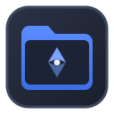
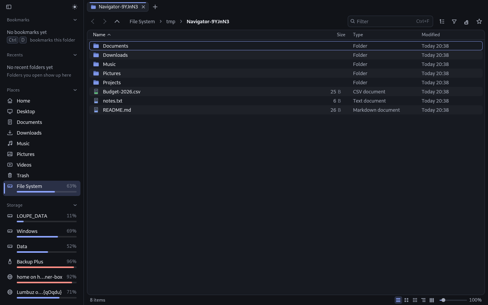
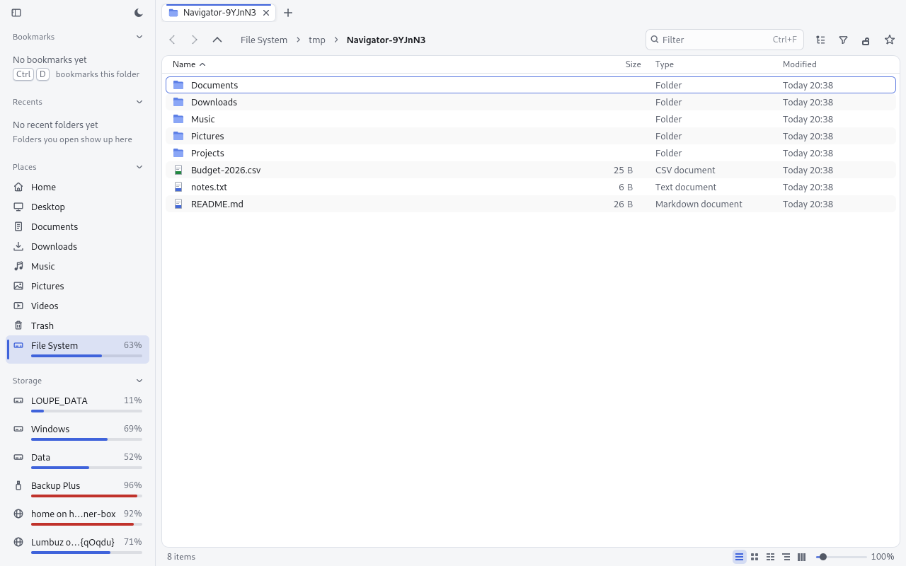

<p align="center">
  
</p>

<h1 align="center">Navigator</h1>

<p align="center">
  A fast, clean, keyboard-first file manager for Linux.
</p>

<p align="center">
  
</p>

---

## Highlights

- **Split Panes & Tabs** — Drag-to-split panes, independent tabs per pane, saved layouts, and automatic session restore.
- **5 View Modes** — Switch effortlessly between **Details**, **Icons**, **List**, **Tree**, and **Miller Columns** (`Ctrl+1`–`Ctrl+5`), with live zoom (`Ctrl+=` / `Ctrl+-` / `Ctrl+wheel`).
- **Instant Filtering & Search** — Start typing anywhere to filter files, flatten subfolders (`Ctrl+E`), or search inside file contents (`Ctrl+Shift+G`).
- **Built-in Preview Inspector** — Press `Space` to inspect images, videos, text files, EXIF metadata, and folder summaries.
- **Safe File Operations** — Background copy/move with conflict handling, XDG Trash support, multi-step Undo/Redo (`Ctrl+Z`), and interactive **Batch Rename** (`Shift+F2`).
- **Customizable** — Command Palette (`Ctrl+Shift+P`), remappable shortcuts, Dark & Light themes, custom JSON color schemes, and English / Turkish UI.
- **Linux Extras** — Browse inside `.zip` / `.tar` / `.7z` archives, open terminal here (`F4`), view Git status badges, and access network/device mounts (MTP, SMB, SFTP).

<details>
<summary>Preview Light Theme</summary>
<p align="center">
  
</p>
</details>

---

## Installation (Ubuntu 24.04 / Linux Mint 22+)

Download the latest `.deb` package from [Releases](https://github.com/kaptanoguz/Navigator/releases) and install it:

```bash
sudo apt install ./navigator_0.1.0_amd64.deb
```

### Set as Default File Manager (Optional)

To open folders with Navigator by default on GNOME or Cinnamon:

```bash
xdg-mime default navigator.desktop inode/directory
```

*(You can revert anytime with `xdg-mime default nemo.desktop inode/directory` or `org.gnome.Nautilus.desktop`.)*

---

## Essential Shortcuts

| Shortcut | Action |
|---|---|
| `Ctrl+Shift+P` | Open Command Palette |
| `Ctrl+1` – `Ctrl+5` | Switch view (Details, Icons, List, Tree, Columns) |
| `Space` | Toggle Preview Inspector |
| `Ctrl+F` / `Ctrl+E` | Filter folder / Flatten subfolders |
| `Ctrl+Shift+G` | Search inside files |
| `F3` / `Ctrl+T` | Split pane / New tab |
| `F4` | Open terminal here |
| `Shift+F2` | Batch Rename |
| `Ctrl+,` | Open Settings (Keymap & Appearance) |

---

## Building from Source

```bash
cmake --preset release
cmake --build --preset release
```

See [docs/building.md](docs/building.md) for dependencies, and [docs/manual.md](docs/manual.md) for the full user guide.

> Navigator is an independent open-source Linux file manager inspired by File Pilot’s documented UX. It contains no third-party proprietary assets, branding, or binaries.
